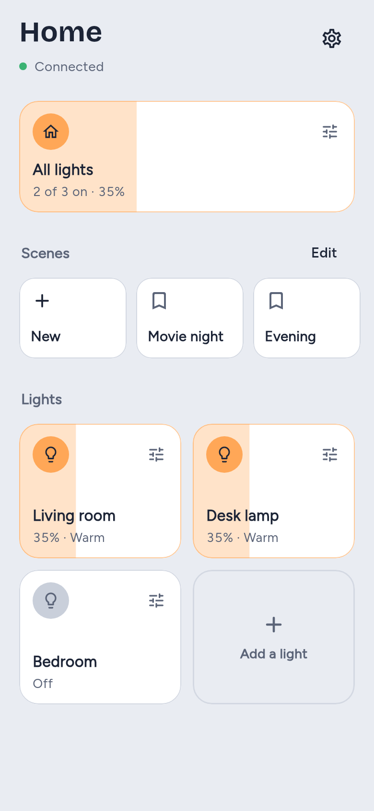
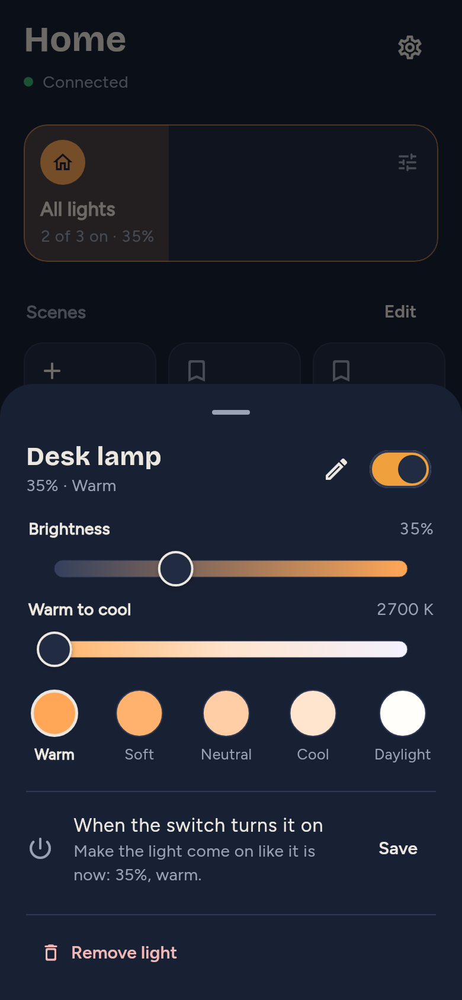
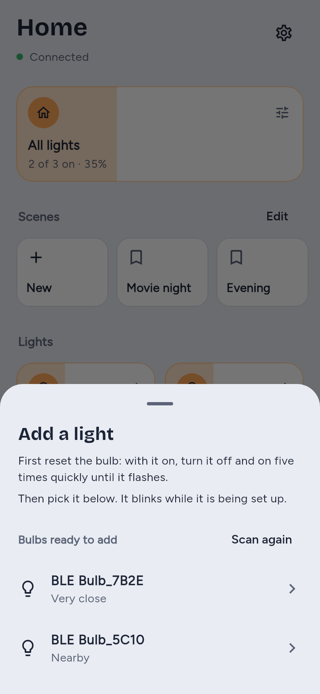

# Lumina

[](https://github.com/mh-anwar/lumina/actions/workflows/ci.yml)

Control Sengled Bluetooth Mesh bulbs from your phone, with no Sengled app, no account and no cloud. Lumina sets up the bulbs on its own mesh network and never touches the internet.

Lumina is a fork of [Luminar](https://github.com/snwagbata/luminar) by snwagbata, with a redesigned interface.

<p align="center">
  &nbsp;&nbsp;
  &nbsp;&nbsp;
  
</p>

## What it does

- **Tap a light to switch it, drag across it to dim it.** The tune button opens warmth, color (on color bulbs), rename and remove.
- **All lights at once** from one tile, in a single group message so they change together. Dragging it dims the lights that are on and leaves the others off.
- **Scenes:** built-in ones (Relax, Read, Daylight, Night), your own brightness-and-white scenes, and snapshots of each light stored on the bulbs.
- **Home-screen widgets and app shortcuts** (Android) that work without opening the app.
- **Backups:** a code that moves your lights to another phone.
- **Private by design:** no internet permission, no analytics, no accounts.

Tunable white bulbs go from warm (2700 K) to daylight (6500 K). Color bulbs also get hue and saturation.

## Install

Download `lumina-vX.Y.Z.apk` from the [latest release](https://github.com/mh-anwar/lumina/releases/latest) on your Android phone (7.0 or newer) and open it. Allow installs from your browser when Android asks, then allow **Nearby devices** when Lumina asks.

Updates install over the old version and keep your lights.

iOS builds but hasn't been tested on an iPhone yet.

## Add a bulb

1. Reset the bulb: with it on, switch it off and on five times quickly until it flashes.
2. In Lumina, tap **Add a light** and pick the bulb (`BLE Bulb_XXXX`). It blinks while it's being set up, which takes about 10 seconds.

A bulb set up with another app, such as Sengled's or nRF Mesh, has to be reset first.

If a bulb gets reset with its light switch later, its tile says **Was reset**. Tap it to set it up again with the same name.

## Widgets and shortcuts (Android)

- **Lights on/off** (1×1) switches every light.
- **Lights and scenes** (4×1) adds Relax, Read, Daylight and Night.
- **One light** (1×1) switches the light you pick when you add it.

## Backups

**Settings → Back up lights** gives you a `LAMPLIGHT1:` code. Keep it somewhere private, like a password manager: it holds your network keys. **Restore from backup** on another phone brings your lights back. Codes from the Lamplight web app work too.

## Troubleshooting

- **No lights found:** make sure the bulbs have power and you're close to one of them. Close nRF Mesh or other light apps, which can hold the connection.
- **A bulb doesn't show under Add a light:** it's still set up somewhere else. Reset it (five quick off/on cycles).
- **Something else:** **Settings → Activity log** shows every message to and from the bulbs. **Share** sends it wherever you like.

## Development

<details>
<summary>Building, tests and project layout</summary>

### Build and test

```bash
flutter test                          # unit, repository and widget tests
flutter build apk --release           # signed with the debug key unless android/key.properties exists
flutter test tool/screenshots/take_screenshots.dart   # regenerates docs/screenshots/
```

After changing a `freezed` model, run `dart run build_runner build --delete-conflicting-outputs` and commit the generated files.

CI checks formatting, analysis, tests and generated code on every push to `main`, and uploads screenshots of the app as a build artifact.

### Layout

The app follows the Flutter architecture guide: views and view models over repositories and services.

| Path | What's there |
|---|---|
| `lib/data/mesh/` | Pure Dart Bluetooth Mesh: key derivation, network PDUs, segmentation, proxy, provisioning, access messages. |
| `lib/data/services/` | Bluetooth (`BleService`), the proxy connection (`MeshProxyService`), provisioning, storage (`HomeStore`), widgets, the activity log. |
| `lib/data/repositories/` | Sources of truth: home and keys, connection, lights, scenes, provisioning, widgets. |
| `lib/domain/` | Immutable models and the use cases that span repositories. |
| `lib/ui/` | One folder per feature (`home`, `add_light`, `activity_log`), plus shared theme and widgets. |
| `lib/widget_entry.dart` | Background entry point for widget and shortcut taps. |
| `test/` | Mirrors `lib/`. Protocol tests check against independent test vectors, and everything else runs against simulated bulbs (`test/support/`). |

### Protocol notes

At setup, Lumina reads each bulb's Composition Data and binds its AppKey to Generic OnOff, Light Lightness, Light CTL (and CTL Setup), Light HSL on color bulbs, Scene (and Scene Setup) and Scheduler (and Scheduler Setup).

- The bulbs have no Time Server, so Scheduler messages are implemented but schedules may never fire.
- The vendor model `0x05040000` is undocumented.
- Sequence numbers only ever go up. Restoring a backup adds 100,000 so the bulbs don't reject messages as replays.

### Icon and splash

```bash
flutter test tool/brand/render_brand_assets.dart
dart run flutter_launcher_icons
dart run flutter_native_splash:create
```

### iOS

`flutter build ios --no-codesign` checks that it builds. To run it on an iPhone, open `ios/Runner.xcworkspace` in Xcode and pick your team under **Signing & Capabilities**. The iOS Simulator has no Bluetooth.

</details>

## License

[MIT](LICENSE). The bundled Figtree and Bricolage Grotesque fonts are under the SIL Open Font License (`google_fonts/`), and the icons are Material Icons under Apache 2.0.

Lumina isn't affiliated with or endorsed by Sengled. Sengled is a trademark of its owner, used here only to say which bulbs Lumina works with.
